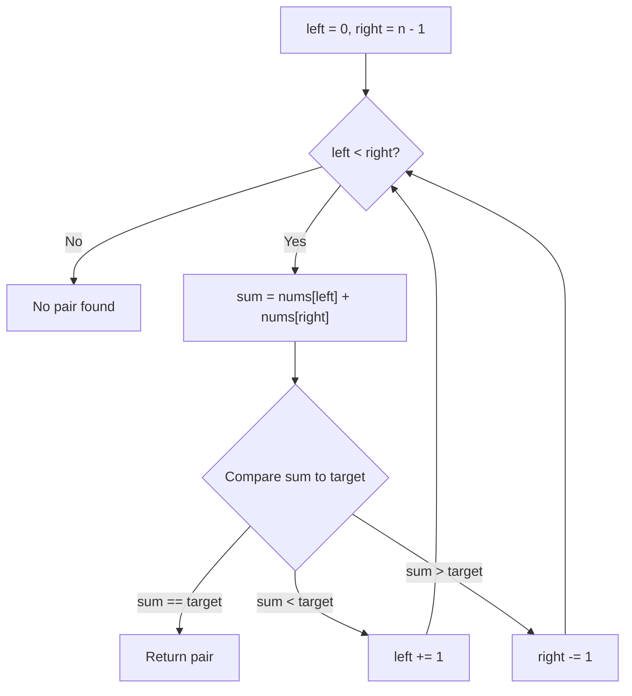

# Two Pointers Technique — DSA Notes

> Beginner-friendly notes for learning, practicing, and revising the Two Pointers pattern in Python.

## Contents
- [Definition](#definition)
- [When to use it](#when-to-use-it)
- [Pattern 1: Opposite-direction pointers](#pattern-1-opposite-direction-pointers)
- [Pattern 2: Same-direction pointers](#pattern-2-same-direction-pointers)
- [Pattern 3: Fast and slow pointers](#pattern-3-fast-and-slow-pointers)
- [Pattern 4: Sliding window](#pattern-4-sliding-window)
- [Complexity](#complexity)
- [Common mistakes](#common-mistakes)
- [Practice checklist](#practice-checklist)
- [Quick revision](#quick-revision)

---

## Definition

**Two Pointers** is an algorithm technique that uses two index variables or references to track positions in a data structure. The pointers move according to a rule so we can avoid unnecessary repeated work.

A pointer in these examples usually means an **index variable** (`left`, `right`, `slow`, or `fast`), not necessarily a C memory pointer.

### Why use it?

A brute-force pair search often takes `O(n²)` time. With the right structure and movement rule, two pointers can solve the same problem in `O(n)` time and `O(1)` extra space.

## When to use it

Look for clues such as:
- The input is sorted, and the problem asks for a pair or target sum.
- You compare the beginning and end of a string or array.
- You need to modify an array in-place.
- You need to find a linked-list middle or detect a cycle.
- You need to maintain a contiguous range (often sliding window).

**Important:** Two pointers is not automatically faster. You need a valid reason for moving a pointer and, for opposite-direction sum problems, sorted input is usually essential.

---

## Pattern 1: Opposite-direction pointers

### Definition
Start one pointer at the beginning and another at the end. Move them toward each other.

### Visual

```text
Array: [ 1, 2, 4, 6, 8, 9 ]
         L               R
         └──── inward ───┘
```

### Example: Two Sum in a sorted array

Find two values that add up to `11`.

```python
def two_sum_sorted(nums, target):
    left = 0
    right = len(nums) - 1

    while left < right:
        total = nums[left] + nums[right]

        if total == target:
            return [left, right]
        elif total < target:
            left += 1       # Need a larger sum
        else:
            right -= 1      # Need a smaller sum

    return []

print(two_sum_sorted([1, 2, 4, 6, 8, 9], 11))
# [1, 5]  -> values 2 and 9
```

### Decision diagram



### Why the movement works
- If the sum is too small, move `left` forward to a larger value.
- If the sum is too large, move `right` backward to a smaller value.
- This reasoning relies on the array being sorted in ascending order.

### Another example: Palindrome check

```python
def is_palindrome(text):
    left, right = 0, len(text) - 1

    while left < right:
        if text[left] != text[right]:
            return False
        left += 1
        right -= 1

    return True

print(is_palindrome("racecar"))  # True
print(is_palindrome("python"))   # False
```

---

## Pattern 2: Same-direction pointers

### Definition
Both pointers move from left to right. One often scans (`fast`), while the other tracks where the next useful value belongs (`slow`).

### Visual

```text
Values: [ 1, 1, 2, 2, 3, 4, 4 ]
          S  F

S = last unique value
F = scanning pointer
```

### Example: Remove duplicates from a sorted array in-place

```python
def remove_duplicates(nums):
    if not nums:
        return 0

    slow = 0

    for fast in range(1, len(nums)):
        if nums[fast] != nums[slow]:
            slow += 1
            nums[slow] = nums[fast]

    return slow + 1

nums = [1, 1, 2, 2, 3, 4, 4]
k = remove_duplicates(nums)

print(k)        # 4
print(nums[:k]) # [1, 2, 3, 4]
```

The first `k` positions contain the unique values. The remainder of the array is not important.

**Complexity:** `O(n)` time, `O(1)` extra space.

Other uses: move zeroes, remove a value in-place, stable filtering, partitioning.

---

## Pattern 3: Fast and slow pointers

### Definition
Two pointers move at different speeds. A common linked-list version moves `slow` one node and `fast` two nodes per iteration.

### Visual: find the middle

```text
10 -> 20 -> 30 -> 40 -> 50 -> None
               S
                              F (reaches end)
```

### Example: Find the middle node of a linked list

```python
def middle_node(head):
    slow = fast = head

    while fast is not None and fast.next is not None:
        slow = slow.next
        fast = fast.next.next

    return slow
```

When `fast` reaches the end, `slow` is at the middle. For an even number of nodes, this version returns the **second** middle node.

**Complexity:** `O(n)` time, `O(1)` extra space.

Other use: Floyd's cycle detection (also called Tortoise and Hare).

---

## Pattern 4: Sliding window

Sliding window is closely related to two pointers and is often taught as its own pattern. It maintains a contiguous range between two boundaries.

### Visual: fixed window of size 3

```text
[ 2, 1, 5, 1, 3, 2 ]
  └─────┘             sum = 8
     └─────┘          sum = 7
        └─────┘       sum = 9  <- maximum
           └─────┘    sum = 6
```

### Example: Maximum sum of a subarray of size `k`

```python
def max_sum_subarray(nums, k):
    if k <= 0 or k > len(nums):
        raise ValueError("k must be between 1 and len(nums)")

    window_sum = sum(nums[:k])
    best = window_sum

    for right in range(k, len(nums)):
        window_sum += nums[right]       # Add incoming value
        window_sum -= nums[right - k]   # Remove outgoing value
        best = max(best, window_sum)

    return best

print(max_sum_subarray([2, 1, 5, 1, 3, 2], 3))
# 9
```

**Complexity:** `O(n)` time, `O(1)` extra space.

---

## Complexity

| Pattern / approach | Typical time | Extra space |
|---|---:|---:|
| Brute-force pair checking | `O(n²)` | `O(1)` |
| Opposite-direction pointers | `O(n)` | `O(1)` |
| Same-direction pointers | `O(n)` | `O(1)` |
| Fast/slow linked-list pointers | `O(n)` | `O(1)` |
| Fixed-size sliding window | `O(n)` | `O(1)` |

These are typical complexities for the examples above. Actual complexity depends on the algorithm and any extra data structures used.

## Common mistakes

1. **Using opposite pointers on unsorted input without a valid strategy.** The sum-based movement rule depends on sorted order.
2. **Using `left <= right` when the problem requires two distinct elements.** Usually use `left < right`.
3. **Forgetting to move a pointer.** This can create an infinite loop.
4. **Moving the wrong pointer.** For sorted two-sum, small sum means move left; large sum means move right.
5. **Accessing `fast.next.next` without checking `fast` and `fast.next`.**
6. **Assuming the whole array is valid after in-place filtering.** Often only the first `k` positions are meaningful.
7. **Confusing sliding window with every two-pointer problem.** A sliding window specifically represents a contiguous range.

## Practice checklist

Try these in order:

- [ ] Reverse a string
- [ ] Valid Palindrome
- [ ] Two Sum II — Input Array Is Sorted
- [ ] Remove Duplicates from Sorted Array
- [ ] Move Zeroes
- [ ] Remove Element
- [ ] Middle of the Linked List
- [ ] Linked List Cycle
- [ ] Container With Most Water
- [ ] Maximum Sum Subarray of Size K

For each problem, write down:
1. What does each pointer represent?
2. Where does each pointer start?
3. What condition moves each pointer?
4. Why is it safe to discard the current position or range?
5. What is the time and extra-space complexity?

## Quick revision

| Pattern | Pointer setup | Main clue |
|---|---|---|
| Opposite direction | `left = 0`, `right = n - 1` | Sorted pair, palindrome, inward scan |
| Same direction | `slow`, `fast` both move forward | In-place filtering / overwrite |
| Fast and slow | `slow += 1 step`, `fast += 2 steps` | Linked-list middle or cycle |
| Sliding window | `left` and `right` bound a range | Contiguous subarray / substring |

### One-line memory trick

- **Opposite:** meet in the middle.
- **Same direction:** scan and keep.
- **Fast/slow:** different speeds.
- **Sliding window:** expand and shrink a range.

---

Happy learning! Keep practicing, and focus on explaining *why* each pointer moves—not just memorizing the code.
